# UNVEIL: Let Your Talent Be Seen

> A web platform where beginners upload their talent, get votes and feedback, climb fair rankings, join open online competitions and build a creator portfolio.

**Team Leader:** Chaturthi H V
**Team Members:** Drishti Hegde, Disha G, Anagha Bhat

---

## 1. Project Title and Description

**UNVEIL** is a talent-discovery platform for people who have skill but no audience yet. Creators upload music, art, code projects, dance, writing or video links. The community votes and leaves structured feedback. Ranking rules are public, so newcomers can be discovered on merit. Creators also join time-boxed online competitions and collect achievements on a public portfolio profile.

## 2. Problem Statement

- On YouTube and Instagram, new creators are buried under established ones, so good work from beginners is never seen.
- Talent-show apps are closed, seasonal or invite-only, so ordinary students and hobbyists cannot take part.
- Feedback on big platforms is mostly likes and noise. Beginners get few specific, useful responses.
- Ranking rules are usually hidden, so people do not trust the results.
- Students and beginners have no single place that holds their work, recognition and competition history as a portfolio.

## 3. Target Users

| User | Need |
|---|---|
| Students and beginners | A place to show work without needing followers |
| Artists, musicians, dancers, programmers, hobbyists | Honest feedback and recognition |
| Colleges, clubs and organizations | Run open online competitions |
| Viewers and community members | Discover fresh talent easily |
| Judges and moderators | Score entries fairly and keep content safe |

## 4. Existing Solutions

| Platform | What it does | Gap UNVEIL fills |
|---|---|---|
| [YouTube](https://www.youtube.com) | General video hosting and discovery | New creators are buried. No beginner shelf or open public ranking rules |
| [Behance](https://www.behance.net) | Portfolio platform for creative professionals | Portfolio-focused. No community voting or open competitions for beginners |
| [Talenthouse](https://www.talenthouse.com) | Creative contests run by brands and artists | Contests are brand-driven. No always-on beginner discovery |
| [SoundCloud](https://soundcloud.com) | Audio sharing for musicians | Audio only. No cross-category ranking or competitions |
| [Instagram](https://www.instagram.com) | Social sharing of photos and video | Follower-driven reach. No fair ranking or structured feedback |

## 5. Proposed Solution and Innovation

UNVEIL stands out by being built for beginners first:

1. **New Talent shelf.** Entries from the last 14 days with few votes get their own shelf, so newcomers are not buried.
2. **Transparent rankings.** A public "How rankings work" page explains Top, Trending and competition scoring. Trending uses `weight = 1 / (1 + age_in_days)` per vote.
3. **Fair voting.** One vote per user per entry, enforced by a unique database index. Self-votes are rejected, and suspicious voting bursts are flagged for admin review.
4. **Structured feedback.** One-tap feedback chips (for example "clear audio", "great composition") plus threaded comments give specific praise instead of only numbers.
5. **Open competitions.** Time-boxed contests with a public formula: `Final = (vote share x vote weight) + (judge average x judge weight)`.
6. **Portfolio profile.** Pinned best work, achievements, competition history and followers in one public page.
7. **Signature "unveil" moment.** A curtain-and-spotlight reveal on the home hero and entry page, which respects reduced-motion settings.

## 6. MVP Features (first working version)

**Accounts**
- [ ] Sign up, log in, log out (JWT)
- [ ] Roles: Visitor, Creator, Admin

**Talent entries**
- [ ] Upload image, audio, or a YouTube/Vimeo link, with title, description, category and tags
- [ ] Categories (music, art, coding, dance, etc.)
- [ ] Edit and delete own entries

**Discovery**
- [ ] Home page with Trending and New Talent shelf
- [ ] Explore page with category filter, search and sort (Trending, New, Top)
- [ ] Entry detail page

**Engagement**
- [ ] One vote per user per entry (self-votes blocked)
- [ ] Comments
- [ ] Feedback chips
- [ ] Leaderboard by category and period (week, month, all-time)

**Profiles**
- [ ] Creator profile with bio, entries and vote totals

**Competitions (basic)**
- [ ] Admin creates a competition with dates and rules
- [ ] Creators submit entries, and the leaderboard shows standings

**Safety**
- [ ] Report an entry or comment
- [ ] Basic admin page to review reports and hide content

_Planned after MVP:_ email verification, judge panel with rubric, notifications, follow feed, favorites and collections, analytics, drafts and scheduling, dark mode, achievements, weekly digest.

## 7. Suited Technology Stack

We will first implement UNVEIL with **MERN**, and migrate after the final demo.

### Phase 1: MERN (initial implementation)

| Layer | Choice | Why |
|---|---|---|
| Frontend | **React** (Vite) + React Router | Component-based UI, fast to build the many reusable cards, shelves and forms |
| Styling | Tailwind CSS | Quick, consistent, responsive design and easy dark mode |
| Backend | **Node.js + Express** | Simple REST API, same language (JavaScript) as the frontend |
| Database | **MongoDB** (Atlas free tier) + Mongoose | Flexible documents suit entries with different media types. Text indexes give basic search |
| Auth | JWT + bcrypt | Stateless login and secure password hashing |
| Media | Cloudinary (free tier) or Multer + cloud storage | Image and audio hosting and thumbnails without running our own file server |
| Video | Embedded YouTube/Vimeo links | Keeps hosting and bandwidth free |
| Live updates | Socket.io | Live vote counts and notifications |
| Scheduled jobs | node-cron | Recompute rankings and move competitions between stages |
| Security | helmet, express-rate-limit, express-validator, CORS config | Secure headers, rate limits on voting and login, input validation |
| Testing | Jest, Supertest, Playwright | Unit, API and end-to-end tests |
| Version control and CI | GitHub + GitHub Actions | Pull requests, reviews and automatic tests |
| Hosting | Vercel/Netlify (frontend), Render (backend), MongoDB Atlas | Free tiers for demo |

Key data decisions: a compound unique index on `(userId, entryId)` in the votes collection guarantees one vote per user per entry. Ranking results are precomputed by a scheduled job so pages read a ready result.

### Phase 2: Planned migration (after final demo)

ASP.NET Core (modular monolith) + Blazor + PostgreSQL with EF Core, ASP.NET Core Identity (Argon2id), Hangfire, SignalR and Cloudflare R2. This gives strong typing, relational integrity for votes and competitions, and cheap scaling. The REST API design, module boundaries and data model from Phase 1 carry over directly.

## 8. Draft Architectural Flow Diagram

The diagram follows a user from the moment they open UNVEIL to the point where they gain recognition. Box colors show **who in the team builds that part** (see the legend below the diagram).

```mermaid
flowchart TD
    A(["START<br/>User opens UNVEIL"]):::start --> B["Home Page<br/>Trending, New Talent,<br/>Categories"]:::drishti
    B --> C["Explore and Search<br/>Filter by category,<br/>sort Trending / New / Top"]:::disha
    C --> D{"Logged in?"}:::drishti

    D -->|No| E["Sign Up / Login<br/>Page"]:::drishti
    E --> F["Auth API<br/>Validate, hash password,<br/>issue JWT"]:::drishti
    F --> G[("MongoDB<br/>users")]:::db
    G --> H["Token saved,<br/>role applied<br/>Creator / Judge / Admin"]:::drishti
    D -->|Yes| H

    H --> I["Creator Dashboard<br/>and Profile"]:::drishti
    I --> J["Upload Page<br/>File or video link,<br/>title, category, tags"]:::disha
    J --> K["Entries API<br/>Check file type and size,<br/>create entry"]:::disha
    K --> L[("Cloudinary<br/>images and audio")]:::db
    K --> M[("MongoDB<br/>entries")]:::db
    M --> N["Entry Page<br/>Player, details, tags"]:::disha

    N --> O["Viewer taps<br/>Vote"]:::anagha
    O --> P["Votes API<br/>One vote per user,<br/>block self-vote,<br/>rate limit"]:::anagha
    P --> Q[("MongoDB<br/>votes")]:::db
    Q --> R["Socket.io<br/>Live vote count"]:::anagha
    N --> S["Comments and<br/>Feedback Chips"]:::anagha

    Q --> T["Scheduled Job<br/>node-cron<br/>Recompute rankings"]:::anagha
    T --> U["Leaderboard Page<br/>Top and Trending"]:::anagha

    U --> V["Join Competition<br/>Submit entry"]:::chaturthi
    V --> W["Competition API<br/>Stages, scoring,<br/>winners"]:::chaturthi
    W --> X["Winners and<br/>Achievements on<br/>creator profile"]:::chaturthi

    N --> Y["Report<br/>content"]:::chaturthi
    Y --> Z["Admin Panel<br/>Review reports,<br/>hide content,<br/>audit log"]:::chaturthi

    X --> FIN(["END<br/>Creator gains recognition<br/>and portfolio"]):::start

    classDef start fill:#fef9c3,stroke:#a16207,stroke-width:2px,color:#111
    classDef chaturthi fill:#e9d5ff,stroke:#7e22ce,stroke-width:2px,color:#111
    classDef drishti fill:#dbeafe,stroke:#1d4ed8,stroke-width:2px,color:#111
    classDef disha fill:#dcfce7,stroke:#15803d,stroke-width:2px,color:#111
    classDef anagha fill:#ffedd5,stroke:#c2410c,stroke-width:2px,color:#111
    classDef db fill:#e5e7eb,stroke:#374151,stroke-width:2px,color:#111
```




**Color legend**

| Color | Meaning |
|---|---|
| 🟪 Purple | Chaturthi H V: competitions, reports, moderation and admin panel |
| 🟦 Blue | Drishti Hegde: app shell, auth, users, profiles and dashboard |
| 🟩 Green | Disha G: entries, uploads, media, search, Explore and Entry pages |
| 🟧 Orange | Anagha Bhat: votes, comments, feedback, ranking, leaderboard, live updates |
| ⬜ Grey | Databases and storage (MongoDB, Cloudinary) |
| 🟨 Yellow | Start and end of the user journey |

### How to read the flow

1. **Start.** The user opens the Home page and browses Explore without logging in.
2. **Login check.** To vote, upload or comment, the user signs up or logs in. The Auth API validates the input, hashes the password, saves the user in MongoDB and returns a JWT with the user's role.
3. **Upload.** A creator opens the dashboard, fills the upload form and the Entries API checks the file. Media goes to Cloudinary and the entry details go to MongoDB.
4. **Entry page.** The published entry appears, where viewers can vote, comment and leave feedback chips.
5. **Voting.** The Votes API allows one vote per user per entry, blocks self-votes and rate-limits abuse. The vote is stored and the count updates live through Socket.io.
6. **Ranking.** A scheduled job recomputes rankings from the votes and the Leaderboard page reads the ready result.
7. **Competition.** Creators submit entries to a competition, and the Competition API moves it through its stages, calculates scores and picks winners.
8. **End.** Winners and achievements appear on the creator profile, which works as a portfolio.
9. **Moderation (side path).** Any user can report content, and admins review reports, hide content and write to the audit log.

## 9. Repository Structure

Each name in brackets is the team member who owns that file, based on the feature split in Section 10.

```
unveil/
├── README.md
├── .gitignore
├── .github/
│   └── workflows/
│       └── ci.yml                    # run tests on every pull request
├── docs/
│   ├── architecture.md
│   └── images/                       # exported diagrams
│
├── server/                           # Backend: Node.js + Express
│   ├── package.json
│   ├── .env.example
│   ├── server.js                     # starts the server
│   ├── app.js                        # Express app, middleware, routes
│   ├── config/
│   │   ├── db.js                     # MongoDB connection
│   │   └── cloudinary.js             # Cloudinary setup
│   ├── middleware/
│   │   ├── auth.js                   # JWT check (Drishti)
│   │   ├── roleCheck.js              # Creator / Judge / Admin (Drishti)
│   │   ├── rateLimiter.js            # login and vote limits (Anagha)
│   │   ├── upload.js                 # Multer file checks (Disha)
│   │   └── errorHandler.js
│   ├── models/
│   │   ├── User.js                   # Drishti
│   │   ├── Follow.js                 # Drishti
│   │   ├── Entry.js                  # Disha
│   │   ├── Category.js               # Disha
│   │   ├── Vote.js                   # Anagha (unique userId + entryId)
│   │   ├── Comment.js                # Anagha
│   │   ├── FeedbackChip.js           # Anagha
│   │   ├── LeaderboardSnapshot.js    # Anagha
│   │   ├── Competition.js            # Chaturthi
│   │   ├── Achievement.js            # Chaturthi
│   │   ├── Report.js                 # Chaturthi
│   │   └── AuditLog.js               # Chaturthi
│   ├── controllers/
│   │   ├── authController.js         # Drishti
│   │   ├── userController.js         # Drishti
│   │   ├── entryController.js        # Disha
│   │   ├── searchController.js       # Disha
│   │   ├── voteController.js         # Anagha
│   │   ├── commentController.js      # Anagha
│   │   ├── leaderboardController.js  # Anagha
│   │   ├── competitionController.js  # Chaturthi
│   │   ├── reportController.js       # Chaturthi
│   │   └── adminController.js        # Chaturthi
│   ├── routes/
│   │   ├── authRoutes.js
│   │   ├── userRoutes.js
│   │   ├── entryRoutes.js
│   │   ├── voteRoutes.js
│   │   ├── commentRoutes.js
│   │   ├── leaderboardRoutes.js
│   │   ├── competitionRoutes.js
│   │   ├── reportRoutes.js
│   │   └── adminRoutes.js
│   ├── jobs/
│   │   ├── rankingJob.js             # Anagha (node-cron)
│   │   └── competitionJob.js         # Chaturthi (stage changes)
│   ├── sockets/
│   │   └── voteSocket.js             # Anagha (Socket.io)
│   ├── utils/
│   │   ├── generateToken.js
│   │   └── trendingScore.js          # 1 / (1 + age in days)
│   └── tests/
│       ├── auth.test.js
│       ├── entry.test.js
│       ├── vote.test.js
│       └── competition.test.js
│
└── client/                           # Frontend: React (Vite) + Tailwind
    ├── package.json
    ├── vite.config.js
    ├── tailwind.config.js
    ├── index.html
    ├── public/
    └── src/
        ├── main.jsx
        ├── App.jsx                   # routes
        ├── api/
        │   └── axios.js              # API service (Drishti)
        ├── context/
        │   ├── AuthContext.jsx       # Drishti
        │   └── ThemeContext.jsx      # dark mode (Drishti)
        ├── components/
        │   ├── common/               # Navbar, Footer, Loader, ProtectedRoute (Drishti)
        │   ├── entry/                # EntryCard, EntryShelf, MediaPlayer (Disha)
        │   ├── engagement/           # VoteButton, CommentBox, FeedbackChips (Anagha)
        │   ├── competition/          # CompetitionCard, Standings (Chaturthi)
        │   └── unveil/               # curtain-and-spotlight animation (Drishti)
        ├── pages/
        │   ├── Home.jsx              # Drishti
        │   ├── Login.jsx             # Drishti
        │   ├── Signup.jsx            # Drishti
        │   ├── Profile.jsx           # Drishti
        │   ├── Dashboard.jsx         # Drishti
        │   ├── Explore.jsx           # Disha
        │   ├── EntryPage.jsx         # Disha
        │   ├── Upload.jsx            # Disha
        │   ├── Leaderboard.jsx       # Anagha
        │   ├── Competitions.jsx      # Chaturthi
        │   ├── CompetitionDetail.jsx # Chaturthi
        │   └── AdminPanel.jsx        # Chaturthi
        └── styles/
            └── index.css
```

## 10. Team Roles and Technical Work Split

**Team Leader:** Chaturthi H V
**Members:** Drishti Hegde, Disha G, Anagha Bhat

Work is split by **feature**, so each person builds their own part end to end (database model, API and React screens). No task is shared between two people.

### Chaturthi H V (Team Leader): Competitions and Admin
- Repo structure, branch protection and merging pull requests.
- Competition model and APIs: create, publish, entry limits, eligibility, lifecycle (upcoming, open, judging, completed).
- Competition scoring formula, winner calculation and achievement awards.
- Competitions list and detail pages, standings, winners display.
- Report model and APIs, admin panel (review reports, hide content, manage categories and users), audit log.
- Admin and judge role-only pages.

### Drishti Hegde: App Shell, Auth, Users and Profiles
- React (Vite) and Tailwind setup, routing, shared layout, navbar, footer, API service.
- User model, signup and login APIs, bcrypt, JWT, auth middleware and role checks.
- Login and signup pages, auth context, protected routes.
- Home page, creator profile page (bio, entries, achievements), My Dashboard.
- Follow and unfollow, dark mode, the curtain-and-spotlight "unveil" animation.

### Disha G: Entries, Media and Discovery
- Entry, category and tag models, entry CRUD APIs, draft and publish status.
- Multer and Cloudinary upload, file type and size checks, YouTube/Vimeo link support.
- MongoDB text index, search API with filters and sorting, pagination.
- New Talent query (last 14 days, few votes).
- Upload page with progress bar, Explore page (search, filters, infinite scroll), Entry page layout and media player.

### Anagha Bhat: Votes, Feedback and Rankings
- Vote model with a unique `(userId, entryId)` index, vote API, self-vote block, rate limiting, suspicious-vote flags.
- Comment (threaded) and feedback chip models, APIs and UI components.
- node-cron ranking jobs (Top, Trending) and leaderboard snapshots.
- Socket.io live vote counts.
- Leaderboard page with category and period filters, vote button component.

**Shared by everyone:** tests for your own module (Jest, Supertest), bug fixes, and reviewing at least one teammate's pull request.

### Git workflow
- `main` is protected. All changes go through a branch and a pull request.
- Branch names: `feature/<module>`, `fix/<name>`, `docs/<name>`, for example `feature/vote-api`.
- Every pull request is reviewed by at least one teammate before merging.
- Commit messages are short and meaningful, for example `feat: add vote API with unique index`.

### Suggested build order

| Phase | Chaturthi | Drishti | Disha | Anagha |
|---|---|---|---|---|
| 1. Models and setup | Repo, competition and report models | React setup, user model, auth APIs | Entry and category models | Vote, comment and chip models |
| 2. Core APIs and pages | Competition APIs, competitions pages | Login and signup, Home, protected routes | Upload API and page, search | Vote and comment APIs and UI |
| 3. Features | Scoring, winners, admin panel | Profile, dashboard, follow | Explore, Entry page, New Talent | Ranking jobs, leaderboard, Socket.io |
| 4. Finish | Audit log, moderation polish | Dark mode, unveil animation | Drafts, pagination | Anti-abuse flags |

## 11. Disclaimer

Rankings reflect community engagement and competition results. They are not a measure of anyone's talent.
